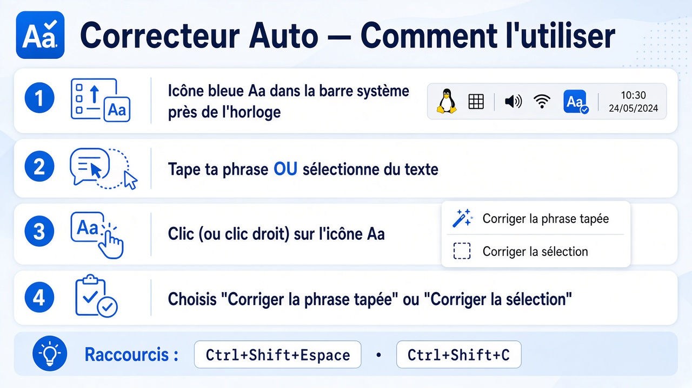

# Correcteur Auto

Correction d’orthographe **français / anglais** pour **Linux (Debian, XFCE, X11)**.  
Tout se passe via une **icône bleue** dans la barre système + une **IA locale (Ollama)** — rien n’est envoyé sur Internet pour corriger.



## Prérequis

- Debian / Ubuntu (ou dérivé), session **X11** (XFCE recommandé)
- ~2 Go libres pour Ollama + modèle léger
- Connexion une fois pour télécharger Ollama / le modèle

## Installation

```bash
git clone https://github.com/THEgrison/correcteur-auto.git
cd correcteur-auto
./install.sh
```

Si besoin des paquets système à la main :

```bash
sudo apt-get install -y python3-tk python3-gi gir1.2-atspi-2.0 \
  libayatana-appindicator3-1 curl zstd xclip
```

## Lancement

```bash
./run.sh
```

Ou menu d’applications → **Correcteur Auto**.

## Utilisation

| Action | Comment |
|--------|---------|
| Corriger ce que tu viens de taper | **Clic** sur l’icône **Aa**, ou `Ctrl+Shift+Espace` |
| Corriger une sélection | Sélectionne le texte → **clic droit sur l’icône** → **Corriger la sélection** |
| Paramètres | Clic droit sur l’icône → **Paramètres…** |
| Activer / désactiver | Clic droit sur l’icône |

### Astuces

- Par défaut, **pas de reformulation** : l’IA garde tes mots et corrige surtout les fautes (`j'aime` reste `j'aime`).
- Active la reformulation dans les paramètres si tu veux une réécriture légère.
- Si le remplacement échoue : le texte corrigé est dans le presse-papiers → `Ctrl+V`.
- Une seule instance à la fois (relancer `./run.sh` ne duplique pas l’app).

## Configuration

Fichier : `~/.config/correcteur-auto/config.json`

Options principales : langue, reformulation, virgules/points/majuscules, modèle Ollama, raccourcis, notifications, démarrage auto.

## Désinstallation

```bash
pkill -f 'python -m correcteur' || true
rm -f ~/.local/share/applications/correcteur-auto.desktop
rm -f ~/.config/autostart/correcteur-auto.desktop
rm -rf ~/correcteur-auto   # ou le dossier du clone
rm -rf ~/.config/correcteur-auto
# Ollama (optionnel) : rm -rf ~/.local/bin/ollama ~/.local/lib/ollama ~/.ollama
```

## Stack

- Python 3.10+ · pystray · pynput · tkinter · AT-SPI  
- [Ollama](https://ollama.com) + modèle `qwen2.5:1.5b` (recommandé sur ~8 Go RAM)

## Licence

MIT — voir [LICENSE](LICENSE).
